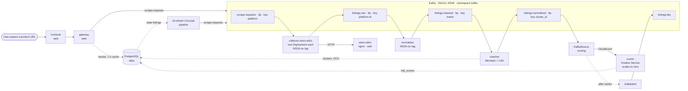

# Architecture

Everything runs in one Kubernetes cluster, in five namespaces: `kafka`, `data`, `pipeline`, `scoring` and `web`. Locally that cluster is k3d with 1 server and 2 agents. The manifests in `k8s/base` are portable; everything specific to k3d lives in `bootstrap/k3d/`. The collectors, normaliser and matcher run the team's code (`web/scraper.py`, `normaliser/core`) through thin Kafka adapters in `adapters/`, and the scorer runs `scorer/` as is. `smoke-consumer` writes `listings.raw` to the `listings` table; placeholder echo services still fill the gateway and frontend slots.

## Design decisions

| Decision | Why |
|---|---|
| **Kafka via Strimzi, KRaft, dual-role KafkaNodePool** | Operator-managed Kafka declared as Kubernetes resources (cluster, node pool, topics), with no ZooKeeper. Dual-role nodes (controller + broker in one JVM) halve the memory of a 3-node cluster. |
| **Two profiles: lite (1 broker, RF 1) and default (3 brokers, RF 3, min ISR 2)** | Our own target was an 8 GB laptop, but the fault-tolerance claim needs replication. With `acks=all` + `min.insync.replicas=2`, an acknowledged message should survive the loss of any one broker, with a short pause while partition leaders fail over (to be measured with 3 brokers). |
| **Topics keyed for locality** | Per-key ordering, and so each normaliser/matcher replica owns a hash range: listings by `platform:id`, `listings.cleaned` by brand (LSH blocking stays within one replica), `listings.normalized` by `cluster_id`. All producers use murmur2 so every language puts a key on the same partition. |
| **At-least-once + idempotent upserts** | Consumers commit offsets only after their write commits, so a crash causes redelivery, never loss. Writes are `INSERT … ON CONFLICT DO UPDATE` with a freshness guard, so redeliveries create no duplicates. Exactly-once transactions were not needed. |
| **Optimistic concurrency on `clusters`** | Matcher replicas may update the same cluster; a `version` check-and-retry avoids lost updates without row locks across services. The column and the pattern (in contracts.md) are ready; the matcher implements it. |
| **KEDA on consumer-group lag** | Lag is the true backlog signal for a Kafka consumer; CPU isn't (a consumer waiting on I/O looks idle). Replicas are capped at the partition count. |
| **Scorer on Knative + KafkaSource** | Scoring is bursty and idle most of the time: scale to zero saves resources. The KafkaSource turns messages into HTTP CloudEvents, retries with backoff, keeps per-partition order, and dead-letters to `listings.dlq` through a KafkaSink, so the scorer stays a plain HTTP service. |
| **Kourier as the Knative ingress** | Lightest Knative networking layer (Envoy-based); no service mesh needed. |
| **PostgreSQL: one StatefulSet, official image** | One source of truth for listings, clusters, scores and the gateway cache; a PVC keeps data across pod restarts. HA Postgres was out of scope. |
| **TTL refresh as a CronJob** | Re-crawls only listings older than a configurable TTL, through the same `scrape.requests` path as user requests. |
| **Helm for operators, Kustomize for our manifests, Make as the entry point** | Third-party operators upgrade as versioned charts (versions in one file); our manifests stay plain YAML with overlays per environment; `make up` is one idempotent command that waits on readiness. |
| **One `images:` list** | Every workload's image is set in `k8s/base/kustomization.yaml`, so swapping a placeholder for a teammate's image changes one entry. |
| **Multi-arch images on GHCR** | The team develops on ARM and x86 laptops; the cloud and the marker may be either. |
